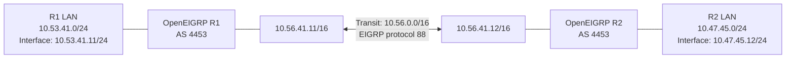

# OpenEIGRP + FRR Docker

`ghcr.io/diivious/openeigrp-frr` packages Alpine Linux, FRRouting (Zebra,
mgmtd, staticd, watchfrr, vtysh), and the OpenEIGRP `eigrpd` daemon.
Published releases contain native Linux `amd64` and `arm64` images behind a
single multi-platform tag. This is a Linux container; Docker Desktop on macOS
is useful for development and container-to-container testing, but does not
provide raw EIGRP adjacency to the physical LAN using its default networking.

## Quick Start

### Pull

Pull a **published** version from GHCR. Version `0.1.0` is an example, not an
assertion that it is already available. The Git publishing tag is
`rel-0.1.0`, while the Docker image tag is `0.1.0`.

```sh
docker pull ghcr.io/diivious/openeigrp-frr:0.1.0
```

For a private GHCR package, authenticate first with an appropriate GitHub
token. Public packages may be pulled without authentication.

### Start

```sh
docker volume create openeigrp-vol
docker run -d --name openeigrp \
  --cap-add NET_ADMIN --cap-add NET_RAW --cap-add SYS_ADMIN \
  -v openeigrp-vol:/etc/frr \
  ghcr.io/diivious/openeigrp-frr:0.1.0

docker ps
```

The volume retains `/etc/frr/frr.conf` and `/etc/frr/daemons` across container
replacement. For an image you have already built locally, you can instead use
`./tools/docker.sh --deploy IMAGE:TAG` (see Development).

`NET_ADMIN` and `NET_RAW` are needed for the router and IP protocol 88. This
FRR build also needs `SYS_ADMIN` for its Linux capability setup; this is a
broad privilege and should be granted only to trusted images on suitably
isolated hosts. For direct adjacency on a **Linux host LAN**, use
`--network host` instead of Docker's default bridge and ensure IP protocol
**88** and multicast **224.0.0.10** are allowed by the network/firewall.
Bridge networking works for isolated container labs, but does not by itself
expose EIGRP to the physical LAN.

### Configure

```sh
docker exec -it openeigrp vtysh
```

In `vtysh`, for example:

```text
configure terminal
router eigrp savage
 address-family ipv4 unicast autonomous-system 4453
  eigrp router-id 10.44.53.1
  network 10.44.0.0 0.0.255.255
 exit-address-family
exit
write memory
show running-config
show eigrp tech-support
```

Use network and router ID values appropriate to your deployment. `write memory`
saves the unified FRR configuration in the volume. The bundled `daemons`
file enables OpenEIGRP (`eigrpd=yes`) by default. The image has no default SSH
server or password; administrative access uses Docker, for example
`docker exec -it -u root openeigrp sh`.

### Troubleshooting

```sh
docker logs -f openeigrp
docker exec openeigrp pidof watchfrr zebra mgmtd staticd eigrpd
docker exec openeigrp vtysh -c 'show version'
docker exec openeigrp vtysh -d eigrpd -c 'show eigrp tech-support'
docker exec openeigrp vtysh -c 'show running-config'
docker exec openeigrp cat /etc/frr/daemons
docker restart openeigrp
```

If binding your own directory to `/etc/frr`, provide both `frr.conf` and
`daemons`, readable by the FRR daemon user. An initially empty named volume
gets the defaults from the image. The foreground `watchfrr` supervisor makes
container process failures visible through Docker logs.

### Externally managed daemon configuration (netlab / containerlab)

Orchestrators such as netlab can replace `/etc/frr/daemons` before container
startup. The image **defaults to `eigrpd=yes`**, but will start FRR normally
when an external configuration specifies `eigrpd=no`. In that case, the
entrypoint logs a warning that OpenEIGRP routing is unavailable; it does not
silently enable EIGRP or overwrite the supplied file. Core FRR daemons
(`mgmtd`, `zebra`, `staticd`) remain required by this image.

To use EIGRP with netlab's FRR device, explicitly enable the daemon, for example:

```yaml
nodes:
  r1:
    device: frr
    frr.daemons: [eigrpd]
```

If the orchestrator leaves `eigrpd` disabled, the container remains usable for
its enabled FRR services, but EIGRP configuration, adjacencies, and route
exchange will not work until `eigrpd` is enabled and the daemon is started.
The Docker integration test checks both configurations before boot.

## Development

**Before opening a merge pull request, run `make all`** from the repository
root. This sequentially executes build, `check SOURCE=all`, all portable UUTs,
and the quick scale gate. Heavy scale cases and Docker image tests remain
separate qualifications.

**Requirements:** Docker Engine/Desktop with Buildx, Git and `rsync`.
All commands below build a local image only; none pushes to GHCR.

### Simple Makefile interface

```sh
make docker                   # Both local checkouts, including working edits
make docker FRR=../frr        # Explicit FRR checkout (local mode only)
make docker GITHUB=latest     # Highest numeric rel-X.Y.Z OpenEIGRP tag
make docker GITHUB=1.2.3     # Exact OpenEIGRP rel-1.2.3 release
```

Local builds use the OpenEIGRP checkout containing this Makefile and the
FRR checkout at `../frr` by default (or `FRR=/path/to/frr`). The resulting
image is `openeigrp:${USER}-test`. Local branches and uncommitted changes
from both repositories are included. `GITHUB` and `FRR` cannot be combined.

GitHub builds use the selected OpenEIGRP `rel-X.Y.Z` commit, **including that
revision's Dockerfile, patches, and `docker/docker.cfg`**. The config pins
`FRR_REPO`, `FRR_TAG` and `FRR_SHA`; FRR is fetched and checked against the
specified immutable commit. Releases predating `docker.cfg` use the FRR
pin recorded in **their own tagged `tools/docker.sh`** (never the developer's
current pin). The Alpine minor-version default also comes from the selected
release's Dockerfile. The image tag is
`ghcr.io/diivious/openeigrp-frr:X.Y.Z` (built locally, not pushed). The
`GITHUB=latest` selector chooses the highest numeric release tag, not the
latest development branch or a floating FRR tag. GitHub Actions always builds
its triggering exact release tag to avoid races.

### Advanced native script

The native script retains platform, image tag, job count, and source overrides:

```sh
./tools/docker.sh --local my-test --frr-root ../frr \
  --platform linux/arm64 --image openeigrp:my-test --jobs 8
./tools/docker.sh --build 1.2.3 --platform linux/arm64 \
  --image openeigrp:release-test
./tools/docker.sh --build dev-branch --eigrp-ref refs/heads/docker-update \
  --image openeigrp:dev-branch
./tools/docker.sh --test openeigrp:my-test
./tools/docker.sh --verify openeigrp:my-test
./tools/docker.sh --deploy openeigrp:my-test \
  --name openeigrp-test --volume openeigrp-test-vol
```

The optional `--frr-ref` applies only to a nonrelease GitHub development
build. An exact release build never accepts a different FRR ref.

Numeric local `--local X.Y.Z` is a special reproducibility check: it requires
both clean working trees, the matching `rel-X.Y.Z` OpenEIGRP tag at HEAD,
and FRR HEAD equal to the `FRR_SHA` pinned in the current `docker/docker.cfg`.
Normal `make docker` intentionally uses a nonrelease `${USER}-test` tag and
does not impose those restrictions.

All modes use the same managed FRR patch/install/configure/build pipeline.
Patch drift stops the build. Labels retain EIGRP/FRR commit identities;
locally uncommitted changes are not represented by those SHAs.

### Alpine image caching

The Dockerfile uses **`alpine:3.22`** as its build and runtime base. The
correct AMD64 or ARM64 manifest is selected for the target platform. To
prefetch the base image when desired:

```sh
docker pull --platform linux/arm64 alpine:3.22
# Alternatively on AMD64:
docker pull --platform linux/amd64 alpine:3.22
```

Builds reuse Docker's base image and BuildKit compilation cache by default.
Append `--pull-base` to `--local` or `--build` to refresh Alpine explicitly.
Docker Desktop may maintain a separate Buildx cache: `docker pull` does not
guarantee an offline build. `apk` dependencies and source checkout contents
also require network access or previously populated caches. Alpine `3.22`
pins a minor release, **not an immutable digest**; exact historical rebuilds
also need the resolved image digest and APK revisions.

Inspect source version/revision labels with:

```sh
docker image inspect openeigrp:docker-test --format '{{json .Config.Labels}}'
```

## Release/Publishing

### Best practices

- Use one OpenEIGRP Git tag `rel-X.Y.Z` for each publication, regardless of
  whether the project is in beta, gamma, or general availability. `rel-0.1.0`
  produces `ghcr.io/diivious/openeigrp-frr:0.1.0`; the `rel-` prefix is **not**
  part of the Docker image tag.
- Commit, review, and verify sources **before** tagging. Tag the intended
  OpenEIGRP commit (including the Docker workflow). Tags may point to `docker`
  or `master`; a merge to `master` is not a prerequisite for tag publishing.
- Record the compatible FRR repository, tag and commit in `docker/docker.cfg`
  **before** tagging, and commit that file. Both platforms build from the
  OpenEIGRP release commit and its configured FRR tag/verified SHA.
- Treat publication tags as immutable. Protect `rel-*` with GitHub rulesets;
  do not move or reuse a published tag. The publisher refuses to overwrite an
  existing multi-platform version tag. Do not automatically update a `latest`
  tag—select versions explicitly in deployments and record image digests.
- Publish only after **both** architecture verification jobs pass. `--verify`
  tests FRR startup/configuration plus two-router EIGRP adjacency and route
  exchange; it is not a claim of large-scale convergence or Cisco
  interoperability qualification.
- The GitHub Actions publisher needs `packages: write` permission via
  `GITHUB_TOKEN`; ensure Actions and GHCR package permissions permit the
  repository to publish. Set package visibility deliberately (public if
  unauthenticated pulls are desired). No personal access token is normally
  needed by the workflow.

### Quick command reference

Build locally from source or from an exact published source tag:

```sh
make docker
make docker FRR=/path/to/frr
make docker GITHUB=latest
make docker GITHUB=1.2.3

# For custom image names/platforms and post-build integration:
./tools/docker.sh --local my-test --image openeigrp:docker-test
./tools/docker.sh --test openeigrp:docker-test
./tools/docker.sh --verify openeigrp:docker-test
./tools/docker.sh --deploy openeigrp:docker-test \
  --name openeigrp-test --volume openeigrp-test-vol
```

### Validation before publication

Set the name of the local image you intend to test once (same shell):

```sh
IMAGE=openeigrp:docker-test
```

`--test` and `--verify` operate on disposable resources and never alter the
image. `--deploy` creates a persistent container/volume and must use a unique
name if another instance is already running.


### 1. Run the automated Docker integration test

First run the Docker startup UUT (no Docker daemon required; uses Python
and PyYAML):

```sh
./tools/python docker/test/test_docker_start.py
```

Then run the image integration test, using the image you just built:

```sh
./tools/docker.sh --test "$IMAGE"
```

The test performs these checks:

| Test | What it verifies |
| --- | --- |
| Container startup | Container starts and remains running |
| FRR processes | watchfrr, mgmtd, zebra, staticd, eigrpd |
| vtysh | Can communicate with FRR and OpenEIGRP |
| Version | `show eigrp tech-support` reports the image's build version |
| Configuration | Named EIGRP instance, IPv4 AS 4453 |
| Retention | Configuration appears in `show running-config` |
| Save | `write memory` saves configuration |
| Restart | Container restarts and reloads saved configuration |
| Stability | Required processes remain running after restart |
| External daemon config | With `eigrpd=no` before boot, core FRR starts, EIGRP stays stopped, and a warning is logged |
| Re-enable | Changing back to `eigrpd=yes` and restarting restores OpenEIGRP |

A successful test reports a message similar to:

```text
PASS: openeigrp:docker-test — FRR, OpenEIGRP, AS 4453, version docker-test, save/restart, optional eigrpd
```

The integration test uses a temporary container and Docker volume, removing
both afterward. It does **not** check EIGRP neighbor formation or run the
portable/Unix UUT suite; `--verify` adds the two-router network tests.

### 2. Deploy and inspect OpenEIGRP manually

After the integration test passes, deploy the image for interactive use:

```sh
./tools/docker.sh --deploy "$IMAGE" --name openeigrp-test --volume openeigrp-test-vol
```

Verify that the container is running and the required FRR processes exist:

```sh
docker ps
docker exec openeigrp-test pidof watchfrr zebra mgmtd staticd eigrpd
```

Open the FRR CLI:

```sh
docker exec -it openeigrp-test vtysh
```

Within vtysh, inspect the installation and configuration:

```text
show version
show daemons
show eigrp tech-support
show running-config
```

You can inspect the startup and runtime logs from the host:

```sh
docker logs --tail 100 openeigrp-test
```

Unlike the automated test, the deployed `openeigrp-test` container uses a persistent configuration
volume and is **not** automatically removed. When finished, run
`docker rm -f openeigrp-test` and optionally `docker volume rm openeigrp-test-vol`.

### 3. Verify actual EIGRP communication and three-network routing

The preceding checks prove that the image starts, runs FRR/OpenEIGRP, and
retains configuration. They do **not** prove that EIGRP packets can be
exchanged or that routes are advertised and learned. This lab uses three
Docker bridges to provide **two different prefix lengths**, a shared /16
transit interface on each router, and a separate /24 LAN interface on each:



There are **three destination networks**, not four: `10.53.41.0/24`,
`10.56.0.0/16`, and `10.47.45.0/24`. The routers must become neighbors only
across `10.56.0.0/16`. R1 must learn R2's `/24`, and R2 must learn R1's `/24`.
The two LAN bridges do not connect to one another.

#### Create the lab networks and containers

```sh
docker network create --driver bridge --subnet 10.56.0.0/16 eigrp-test-transit
docker network create --driver bridge --subnet 10.53.41.0/24 eigrp-test-r1-lan
docker network create --driver bridge --subnet 10.47.45.0/24 eigrp-test-r2-lan

docker run -d --name eigrp-r1 \
  --network eigrp-test-transit --ip 10.56.41.11 \
  --cap-add NET_ADMIN --cap-add NET_RAW --cap-add SYS_ADMIN \
  "$IMAGE"

docker run -d --name eigrp-r2 \
  --network eigrp-test-transit --ip 10.56.41.12 \
  --cap-add NET_ADMIN --cap-add NET_RAW --cap-add SYS_ADMIN \
  "$IMAGE"

docker network connect --ip 10.53.41.11 eigrp-test-r1-lan eigrp-r1
docker network connect --ip 10.47.45.12 eigrp-test-r2-lan eigrp-r2
```

Confirm that each router actually has **two Linux interfaces**, with the
correct address masks:

```sh
docker exec eigrp-r1 ip -o -4 addr show
docker exec eigrp-r2 ip -o -4 addr show
```

#### Configure both routers for AS 4453

```sh
docker exec eigrp-r1 vtysh -d eigrpd \
  -c 'configure terminal' \
  -c 'router eigrp savage' \
  -c 'address-family ipv4 unicast autonomous-system 4453' \
  -c 'eigrp router-id 10.56.41.11' \
  -c 'network 10.56.0.0 0.0.255.255' \
  -c 'network 10.53.41.0 0.0.0.255' \
  -c 'end'

docker exec eigrp-r2 vtysh -d eigrpd \
  -c 'configure terminal' \
  -c 'router eigrp savage' \
  -c 'address-family ipv4 unicast autonomous-system 4453' \
  -c 'eigrp router-id 10.56.41.12' \
  -c 'network 10.56.0.0 0.0.255.255' \
  -c 'network 10.47.45.0 0.0.0.255' \
  -c 'end'
```

The `network` commands use wildcard masks, while the resulting topology
prefixes use standard `/16` and `/24` masks.

#### Verify neighbor adjacency and route exchange

```sh
docker exec eigrp-r1 vtysh -d eigrpd \
  -c 'show eigrp address-family ipv4 4453 neighbors'
docker exec eigrp-r2 vtysh -d eigrpd \
  -c 'show eigrp address-family ipv4 4453 neighbors'

docker exec eigrp-r1 vtysh -d eigrpd \
  -c 'show eigrp address-family ipv4 topology 4453'
docker exec eigrp-r2 vtysh -d eigrpd \
  -c 'show eigrp address-family ipv4 topology 4453'
```

**Expected result:** R1 has neighbor `10.56.41.12`, and R2 has neighbor
`10.56.41.11`. Each topology contains these exact three prefixes:

| Prefix | R1 | R2 |
| --- | --- | --- |
| `10.56.0.0/16` | Connected transit | Connected transit |
| `10.53.41.0/24` | Connected LAN | Learned via `10.56.41.11` |
| `10.47.45.0/24` | Learned via `10.56.41.12` | Connected LAN |

To inspect each **remote** route and its next hop directly:

```sh
docker exec eigrp-r1 vtysh -d eigrpd \
  -c 'show eigrp address-family ipv4 topology 4453 10.47.45.0/24'
docker exec eigrp-r2 vtysh -d eigrpd \
  -c 'show eigrp address-family ipv4 topology 4453 10.53.41.0/24'
```

If verification fails before adjacency, the tool also prints each router's
IGMP memberships and captures Ethernet frames carrying IP protocol 88 on
its transit interface for 12 seconds. Compare inbound and outbound frames
on R1/R2 to distinguish Docker multicast forwarding problems from EIGRP
receive-path problems. Packet capture is passive and runs only in the
verification containers; it does not modify the image or host bridge.

`tools/docker.sh --verify` performs these checks automatically, requiring
both remote prefixes to be learned through the peer, as well as exactly
three topology destinations on each router. It checks again after an interval
to reject transient success. This verifies basic route advertisement and
learning, but not complete convergence qualification or Cisco interoperability.

If neighbor formation or learning fails, inspect interfaces, packet counters,
and logs:

```sh
docker exec eigrp-r1 vtysh -d eigrpd \
  -c 'show eigrp address-family ipv4 4453 interfaces'
docker exec eigrp-r1 vtysh -d eigrpd \
  -c 'show eigrp address-family ipv4 4453 traffic'
docker logs --tail 100 eigrp-r1
docker logs --tail 100 eigrp-r2
```

When finished, remove **only these manual lab resources**, including Docker's
anonymous configuration volumes. Your separate persistent test deployment and
its named configuration volume remain untouched:

```sh
docker rm -fv eigrp-r1 eigrp-r2
docker network rm eigrp-test-r1-lan eigrp-test-r2-lan eigrp-test-transit
```

The two-router test is automated by `tools/docker.sh --verify`. GitHub Actions
also runs `--verify` on both native architectures before publishing any
GHCR release image.

### Publish a reviewed version through GitHub Actions

Select a committed OpenEIGRP revision, for example the `docker` branch:

```sh
git switch docker
git status --short           # must be clean
git log -1 --oneline         # review the exact commit
git tag -a rel-0.1.0 -m 'OpenEIGRP Docker release 0.1.0'
git push origin refs/tags/rel-0.1.0
```

A `rel-X.Y.Z` tag push runs `.github/workflows/docker.yml` **from the tagged
commit**, building native `amd64` and `arm64` images. Both jobs run
`./tools/docker.sh --verify`; only if both succeed does the publish job push
`X.Y.Z-amd64`, `X.Y.Z-arm64`, and the combined `X.Y.Z` manifest to
`ghcr.io/diivious/openeigrp-frr`. Ordinary pushes to `master` or `docker` affecting the workflow's watched
paths, pull requests, and manual workflow runs are build-and-test-only; they
never publish. Manual dispatch is
available only when the workflow is on the default branch, but a tagged
commit can trigger tag publication independently.

Release example (not a claim of an already published image):

```text
ghcr.io/diivious/openeigrp-frr:0.1.0
ghcr.io/diivious/openeigrp-frr:0.1.0-amd64
ghcr.io/diivious/openeigrp-frr:0.1.0-arm64
```

Monitor the build and publication results at
[OpenEIGRP Docker GitHub Actions](https://github.com/diivious/eigrp/actions/workflows/docker.yml).
If the published image is used for deployment, pull and verify it on the
actual target platform:

```sh
docker pull ghcr.io/diivious/openeigrp-frr:0.1.0
./tools/docker.sh --verify ghcr.io/diivious/openeigrp-frr:0.1.0
./tools/docker.sh --deploy ghcr.io/diivious/openeigrp-frr:0.1.0 \
  --name openeigrp-release-test --volume openeigrp-release-test-vol
```

The deployment command creates a persistent test instance; it does not
replace an existing container. GitHub Actions qualifies the image inside
Docker networks, **not** on physical Cisco/EIGRP networks. Production rollout,
site-specific routing policy, security, and interoperability remain separate
acceptance decisions.
