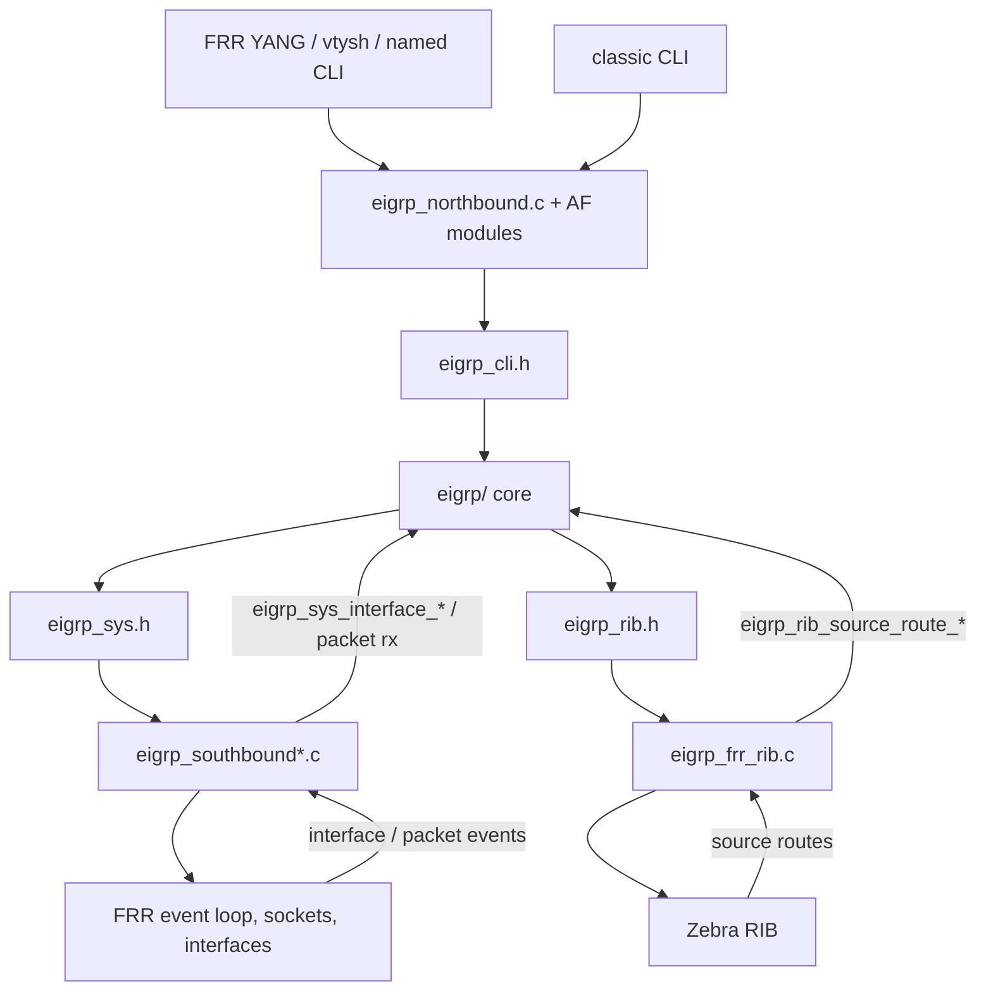
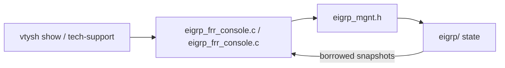

# FRR host adapter

This directory is the FRR shim. It is not portable EIGRP.

The detailed FRR integration contract and end-to-end call flows are in
`specs/integration.md`. The host-neutral integration contract is
`../specs/platform-integration.md`.

If you were told to add EIGRP to some other platform, do not copy this
directory wholesale. Read the host-neutral specification first; use the FRR
specification only as a concrete implementation of that contract.

Portable protocol code stays in `../eigrp/code/`. Tools that stage this tree into
an FRR checkout live in `../tools/`.

## What a host shim is

A host shim has four jobs:

1. Implement the services in `eigrp/code/eigrp_sys.h`.
2. Implement the host side of `eigrp/code/eigrp_rib.h`.
3. Call `eigrp/code/eigrp_cli.h` from the platform config/admin path.
4. Call `eigrp/code/eigrp_mgnt.h` from show, tech-support, or telemetry.

Shared values come from `eigrp/code/eigrp.h`.

A new platform compiles `eigrp/code/*.c`, links its own adapter objects, and does
not compile the files in this directory.

## FRR control and data paths

This section is an orientation map. `specs/integration.md` is authoritative for
the concrete FRR -> shim -> core and core -> shim -> FRR call flows.


Config commit. YANG and classic/named CLI both have to land on the same
`eigrp_cli.h` target. Named mode is the surface for new work.

```text
vtysh / frr-reload / netconf
        |
        v
FRR YANG + VTY parser          frr/code/eigrp_frr_named.c
        |                      frr/code/eigrp_frr_classic.c
        |                      frr/patch YANG schema
        v
northbound adapter             frr/code/eigrp_northbound.c + AF-specific modules
        |
        | eigrp_cli.h
        v
portable core                  eigrp/code/
        |
        +-- eigrp_sys.h -----> southbound     frr/code/eigrp_southbound*.c
        |                      sockets, timers, multicast, IPv4 I/O
        |
        +-- eigrp_rib.h -----> zebra adapter  frr/code/eigrp_frr_rib.c
                               install / withdraw / redistribute
```



Show and debug do not walk DUAL objects. They ask core for snapshots.

```text
vtysh show
   |
   v
eigrp_frr_console.c / eigrp_frr_console.c
   |
   | eigrp_mgnt.h
   v
core neighbor / interface / topology / stats snapshots
```



Packet path is host bytes in, EIGRP payload out. The shim does not decode
route TLVs.

```text
kernel / socket
   |  IPv4 proto 88
   v
eigrp_frr_ipv4.c     eigrp_sys_ipv4_packet_receive
   |
   v
eigrpd packet / RTP / DUAL
   |
   v
eigrp_frr_ipv4.c     eigrp_sys_ipv4_packet_send
   |
   v
kernel / socket
```

## File map

| File | Job | Public header it should sit on |
|---|---|---|
| `eigrp_southbound.c` | AF-independent host service dispatch | `eigrp_sys.h` |
| `eigrp_frr_rib.c` | route install/remove and redistribution feed | `eigrp_rib.h` |
| `eigrp_frr.c` / `eigrp_frr.h` | convert FRR `prefix` / `interface` objects into EIGRP values | `eigrp.h`, `eigrp_sys.h` |
| `eigrp_northbound.c` | AF-independent committed FRR config to semantic EIGRP targets | `eigrp_cli.h` |
| `eigrp_frr_ipv4.c`, `eigrp_frr_ipv6.c` | AF-specific FRR value adaptation plus socket, multicast, and packet I/O | `eigrp_cli.h`, `eigrp_sys.h` |
| `eigrp_frr_named.c` | named-mode CLI front end | host parser only, then `eigrp_cli.h` |
| `eigrp_frr_classic.c` | classic CLI front end | host parser only, then `eigrp_cli.h` |
| `eigrp_frr_console.c` / `eigrp_frr_console.c` | show and operational output | `eigrp_mgnt.h` |
| `eigrp_frr_policy.c` | FRR route-map / filter lookup | `eigrp_sys.h` policy calls |
| `eigrp_main.c` | FRR process, signals, init/teardown | host lifecycle, then `eigrp_sys.h` / `eigrp_rib.h` |
| `eigrp_log.c` | FRR zlog sink for `eigrp_log()` | replaces the stderr fallback in `eigrp/code/eigrp_log.c` |
| `eigrp_frr_vrf.c` | FRR VRF glue | host identity only |
| `eigrp_frr_snmp.c` | optional SNMP | not part of the base five-header contract |
| `patch/` | FRR-wide YANG/vtysh changes outside `eigrpd/` | host tree, not portable core |

`subdir.am` is the FRR automake fragment used after staging. Do not treat it as
the portable file list. It names both `eigrpd/` sources and these adapter
files after they have been flattened into FRR's `eigrpd/` directory.

## How FRR is built

The supported FRR path is documented in the top-level `README.md` and in
`tools/README.md`:

```sh
frr/tools/frr.sh --install --frr-root ../frr
frr/tools/frr.sh --patch --frr-root ../frr
frr/tools/frr.sh --build --frr-root ../frr
```

`--install` copies `eigrp/code/` plus the adapter files in `code/` into `frr/eigrpd/`.
`--patch` applies `patch/` onto FRR sources outside that directory.

## What not to copy onto a new host

Current FRR adapter files still include some private portable headers
(`eigrp_structs.h`, topology/neighbor module headers). That is
existing host debt. It is not the integration model.

A new shim must:

- include only `eigrp.h`, `eigrp_cli.h`, `eigrp_mgnt.h`, `eigrp_rib.h`,
  `eigrp_sys.h`, plus host-native headers
- convert host objects at the adapter boundary
- walk neighbors and topology through `eigrp_mgnt.h` snapshots
- install routes with `eigrp_rib_route_t`, not DUAL descriptors

If the public contract is missing a call you need, file it as a spec/header
change. Do not reach into `prefix_descriptor` or packet objects from host code.

## Tests

FRR-native daemon tests live in `test/eigrpd/` and are staged to `frr/tests/eigrpd/`; actual topotests live in `test/topotests/` and stage to `frr/tests/topotests/`.
See `test/README.md`.

Live named-mode config/writeback is driven by `frr/tools/frr.sh --uut` and
`frr/tools/frr-uut.sh`.

## Debugging

For FRR daemon debugging, stop any service-managed or manually started EIGRP daemon before launching another instance. From the FRR checkout:

```sh
sudo gdb eigrpd/.libs/eigrpd
```

Useful operational commands include:

```sh
sudo vtysh -d eigrpd -c 'show running-config'
sudo vtysh -d eigrpd -c 'show ip eigrp topology'
sudo vtysh -d eigrpd -c 'show ip eigrp neighbors'
```

Use the event-log operational commands defined in `specs/EIGRP-Config-Guide.md` when diagnosing protocol decisions, convergence, adjacency loss, packet rejection, RTP failure, or RIB discrepancies.

